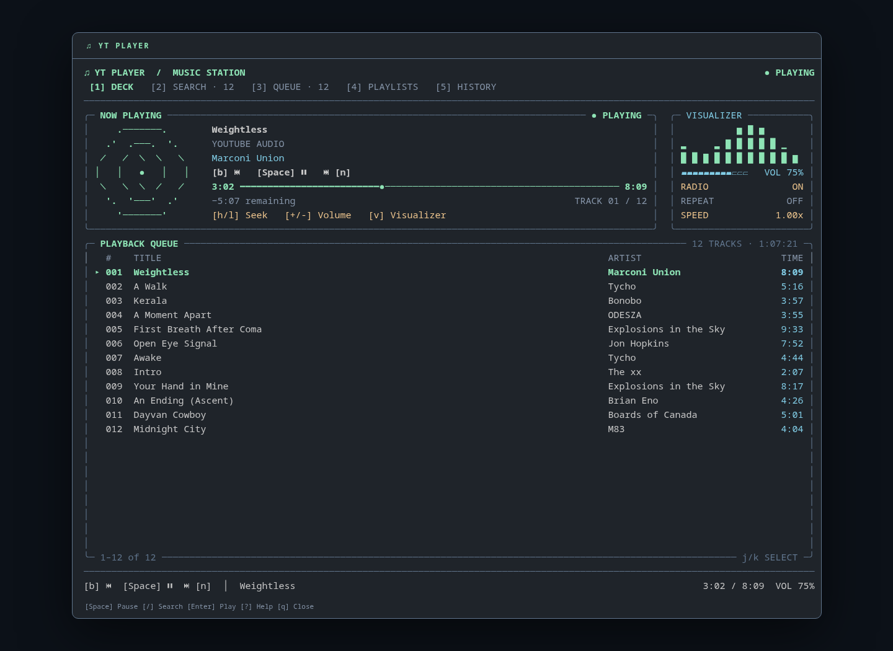

# 🎵 nvim-yt-player

<div align="center">

[](https://github.com/sanjay-np/nvim-yt-player/actions)


**A premium, lightweight, asynchronous YouTube music & audio player built directly inside Neovim.**  
*Powered by pure Lua, UNIX domain socket IPC, mpv, and yt-dlp. Zero external servers. Zero editor lag.*

</div>

---

## 📸 Screenshot

[](docs/media-player.png)

*Rendered preview with sample tracks. Click the image to view it at full size.*

The player opens as a framed terminal music station: an animated record deck, a live visualizer, a formatted queue table with artist and duration columns, and a persistent transport bar. Mint, cyan, and amber accents distinguish playback state, metadata, and controls. All player backgrounds are transparent (including panels, tabs, selections, borders, and search input) so your terminal and editor transparency show through cleanly.

---

## 💡 Why nvim-yt-player?

- 🚀 **Save 1.5GB+ RAM**: Stop keeping memory-hungry browser tabs open just to listen to study or coding music in the background.
- ⚡ **Zero-Freeze Asynchronous IPC**: Communicates directly with a background `mpv` process over a local UNIX domain socket. Stream extraction and playback never block your editor or drop keystrokes.
- ⏩ **Optional SponsorBlock**: Set `sponsorblock = true` to skip sponsor segments, intros, outros, self-promos, and non-music sections so your focus remains uninterrupted (uses `curl`).
- 📻 **Endless Autoplay Radio**: When the last track in the queue starts playing, fetches YouTube Mix recommendations for it and queues them so the music keeps going.
- 👥 **Multi-Instance Sync**: Open Neovim across multiple tmux panes or terminals. They all share one background `mpv`: an instance that finds a player already running attaches to it instead of starting a second one.
- 🎛️ **Zero Dependencies**: Pure Lua + `mpv` + `yt-dlp` (plus `curl` for the optional SponsorBlock). No Python daemons, no Node.js processes, no Electron bloat.

---

## ✨ Features

- **🎨 Terminal Media Station (`:YT`)**:
  - Opens the **TUI Music Station & Unified Hub** (inspired by `cmus` and `ncmpcpp`) featuring an animated vinyl deck, interactive progress bar, live music visualizer, structured queue table, and persistent transport bar.
  - Tabbed interface across **Deck**, **Search**, **Queue**, **Playlists**, and **History**. Reopening with `:YT` always opens the main **Deck** tab by default and starts with a clean search prompt.
- **🪟 Compact Player Layouts**:
  - `:YT mini` — Toggles a floating **Mini HUD** in the top-right corner with record artwork, playback progress, visualizer, and next-track preview.
  - `:YT player` — Toggles a docked sidebar panel with the same deck and framed queue.
- **🔍 YouTube Search with Instant Preview (`:YT search`)**:
  - Search YouTube directly from Neovim. Browse titles, channels, and track durations. Play immediately (`<CR>`), append to queue (`a`), save to playlist (`s`), or paginate for more results (`L`).
- **📝 Interactive Table Queue Editor (`:YT queue_edit`)**:
  - Reorder tracks interactively with `J`/`K`, remove with `dd`, or shuffle the entire queue with `S`. Currently playing track is highlighted in bold green.
- **📁 Master-Detail Playlists Manager (`:YT playlists`)**:
  - Browse local playlists and their tracks across two panes (or toggle with `Tab`). Create (`N`), rename (`r`), play (`<CR>`), queue (`a`), or remove tracks/playlists (`dd` with confirmation).
- **🕐 Play History Timeline (`:YT history`)**:
  - Persistent timeline with relative timestamps (`5m ago`, `2h ago`), instant replay, and one-key queueing. Clear history anytime with `:YT history clear` (or `:YT history_clear`).
- **🎵 Rapid Playlist Ingestion (`:YT queue_playlist`)**:
  - Ingest and parse entire YouTube playlists (100+ tracks) asynchronously in the background. Playback starts right away if nothing is playing.
- **💾 Session Resume (`:YT resume`)**:
  - The queue, current track, position, volume, speed, and repeat mode are saved when Neovim exits and restored with `:YT resume`.
- **✨ Adaptive Themes & Icons**:
  - Fully transparent background support with auto-adaptive palette matching your colorscheme. Supports both Unicode icons and Nerd Font icons (auto-detected via `vim.g.have_nerd_font` or configured explicitly).
- **📊 Statusline & Lualine Integration**:
  - Real-time status reporting with track titles, artists, volume, speed, playback state, and animated progress bars.

---

## 📦 Requirements

Before installing, ensure the following tools are available in your system `PATH`:
- **Neovim** 0.9+
- **mpv** (compiled with Lua support, enabled by default in most distribution packages)
- **yt-dlp**
- **curl** *(optional)*: only needed for SponsorBlock; preinstalled on macOS and most Linux distributions

### Installing `mpv` and `yt-dlp`

#### macOS (Homebrew)

```bash
brew install mpv yt-dlp
```

#### Linux

- **Ubuntu / Debian**:
  ```bash
  sudo apt update
  sudo apt install mpv yt-dlp
  ```
  *(Note: If your distribution repository has an outdated `yt-dlp`, you can install the latest release via `pipx install yt-dlp` or direct binary download).*

- **Arch Linux / Manjaro**:
  ```bash
  sudo pacman -S mpv yt-dlp
  ```

- **Fedora / RHEL**:
  ```bash
  sudo dnf install mpv yt-dlp
  ```

- **openSUSE**:
  ```bash
  sudo zypper install mpv yt-dlp
  ```

- **Alpine Linux**:
  ```bash
  sudo apk add mpv yt-dlp
  ```

---

## 🔧 Installation

Install using your preferred package manager:

### `vim.pack` (Neovim Native Package Manager)

```lua
vim.pack.add({
  { src = "https://github.com/sanjay-np/nvim-yt-player" },
  { src = "https://github.com/nvim-lualine/lualine.nvim" }, -- optional, for statusline component
})

require("yt-player").setup({
  -- your configuration overrides here (see Configuration section)
})
```

### [lazy.nvim](https://github.com/folke/lazy.nvim)

```lua
{
  "sanjay-np/nvim-yt-player",
  dependencies = { "nvim-lualine/lualine.nvim" }, -- optional, for statusline component
  config = function()
    require("yt-player").setup({
      -- your configuration overrides here (see Configuration section)
    })
  end,
}
```

### [packer.nvim](https://github.com/wbthomason/packer.nvim)

```lua
use {
  "sanjay-np/nvim-yt-player",
  requires = { "nvim-lualine/lualine.nvim" }, -- optional
  config = function()
    require("yt-player").setup()
  end,
}
```

### [vim-plug](https://github.com/junegunn/vim-plug)

```vim
Plug 'sanjay-np/nvim-yt-player'
Plug 'nvim-lualine/lualine.nvim' " optional

" In your configuration:
lua require('yt-player').setup()
```

---

## 🚀 Quick Start

1. **Play a track or search query directly**:
   ```vim
   :YT play https://www.youtube.com/watch?v=dQw4w9WgXcQ
   " Or search directly by name:
   :YT play lofi hip hop beats
   ```

2. **Open the Unified Music Hub**:
   ```vim
   :YT
   ```

3. **Search for songs inside the Hub**:
   ```vim
   :YT search lofi chill
   ```

---

## ⌨️ Keymaps & Shortcuts

### Hub Navigation (`:YT`)

When inside the unified Hub window, navigate and control playback with the following keys:

| Key | Action |
|:---|:---|
| `1` – `5` | Switch tab directly: **Deck** (`1`), **Search** (`2`), **Queue** (`3`), **Playlists** (`4`), **History** (`5`) |
| `Tab` / `Shift-Tab` | Cycle tabs forward / backward (or switch between playlist list and track list on Playlists tab) |
| `j` / `k` or `↓` / `↑` | Move selection down / up |
| `gg` / `G` | Jump to first / last item |
| `Ctrl-d` / `Ctrl-u` | Scroll half-page down / up |
| `Enter` (`<CR>`) | Contextual play: play selected track, execute search, or play entire playlist |
| `Space` / `p` | Toggle play / pause |
| `n` / `b` | Skip to next / previous track in queue |
| `+` / `-` | Volume up / down (±5%) |
| `m` | Toggle mute |
| `>` / `<` | Speed up / down (±0.25x) |
| `h` / `l` | Seek ±5s (relative) / switch playlist pane |
| `/` or `i` | Focus YouTube search input (switches to Search tab) |
| `a` / `A` / `<C-a>` | Contextual queue: queue search result, playlist track, or history item; save active queue track |
| `s` | Save selected track to a local playlist |
| `dd` | Remove item from queue / delete playlist (with confirmation) |
| `J` / `K` | Move selected track down / up in queue |
| `S` | Shuffle queue |
| `L` | Load more search results (pagination) |
| `N` | Create a new playlist (Playlists tab) |
| `r` | Toggle autoplay radio mode (on Playlists tab: rename selected playlist) |
| `R` | Cycle repeat mode (**File** 🔂 → **Playlist** 🔁 → **Off**) |
| `v` | Cycle visualizer style (`wave` → `bars` → `dots` → `none`) |
| `?` | Toggle shortcuts cheatsheet overlay |
| `q` / `<Esc>` | Close Hub |

#### Search Input Prompt (Tab 2)
When typing inside the embedded search bar:
- `Enter` (`<CR>` in normal or insert mode): Submit search query
- `↓` / `<C-j>` / `<Tab>` / `j`: Move focus to search results
- `<Esc>`: Return to normal mode
- `q`: Close Hub

---

### Mini HUD (`:YT mini`) & Sidebar (`:YT player`) Controls

When either the docked side-panel (`:YT player`) or floating window (`:YT mini`) is focused:

| Keymap | Action |
|:---:|:---|
| `Space` / `t` | **Toggle** play / pause |
| `p` / `s` | **Play** / **Pause** explicitly |
| `n` / `b` | **Next** / **Previous** track |
| `+` / `-` | **Volume** ±5% |
| `m` | **Mute** toggle |
| `>` / `<` | **Speed** ±0.25x |
| `l` / `h` | **Seek** ±5s (relative) |
| `L` / `H` | **Seek** ±30s (relative) |
| `0` to `9` | **Seek** to percentage (`0%` to `90%` of track) |
| `G` | **Seek** to 100% (ends current track) |
| `r` | **Toggle** autoplay radio mode |
| `R` | **Cycle** repeat mode (Track 🔂 → Playlist 🔁 → Off) |
| `q` / `<Esc>` | **Close** player window |

---

## 📋 Command Reference

All commands are available under the master `:YT` command with tab completion:

| Command | Description |
|:---|:---|
| `:YT` | Open / toggle the Unified Hub (defaults to Deck tab, Tab 1) |
| `:YT play [url or query]` | Play a URL or search query, or resume paused playback |
| `:YT pause` | Pause playback |
| `:YT toggle` | Toggle play / pause |
| `:YT stop` | Stop playback entirely |
| `:YT next` / `:YT prev` | Skip to next / previous track in queue |
| `:YT seek <seconds or MM:SS>` | Seek to absolute position (e.g. `:YT seek 90` or `:YT seek 1:30`) |
| `:YT seek_rel <±seconds>` | Seek relative position (e.g. `:YT seek_rel -10` or `:YT seek_rel 30`) |
| `:YT volume <0-100>` | Set playback volume |
| `:YT vol_up` / `:YT vol_down` | Increase / decrease volume by 5% |
| `:YT mute` | Toggle mute state |
| `:YT speed [value]` | Set or inspect speed (e.g. `:YT speed 1.25`, `:YT speed up`, `:YT speed +0.1`) |
| `:YT shuffle` | Shuffle active queue |
| `:YT repeat_toggle` | Toggle playlist repeat on/off |
| `:YT radio [on\|off\|toggle]` | Toggle or set autoplay radio mode (ON by default) |
| `:YT player` | Toggle docked player sidebar panel |
| `:YT mini` | Toggle top-right floating Mini HUD |
| `:YT search [query]` | Open search tab inside the Hub (with optional query) |
| `:YT queue <url>` | Append track URL to active queue |
| `:YT queue_edit` | Open interactive queue editor inside the Hub (Tab 3) |
| `:YT queue_playlist <url>` | Parse and append an entire YouTube playlist |
| `:YT playlists` | Open local playlists manager inside the Hub (Tab 4) |
| `:YT history` | Open play history timeline inside the Hub (Tab 5) |
| `:YT history clear` / `:YT history_clear` | Clear saved play history |
| `:YT resume` | Restore the queue, track, position, volume, speed, and repeat mode saved when Neovim last exited |

---

## ⚙️ Configuration

Default configuration options:

```lua
require("yt-player").setup({
  ui = {
    nerd_fonts = "auto", -- true, false, or "auto" (respects vim.g.have_nerd_font; otherwise Unicode)
    theme = "auto",      -- automatically inherits your active colorscheme
    border = "rounded",  -- "rounded", "single", "double", "solid", "none"
    visualizer = "wave", -- "wave", "bars", "dots", "none"
    mini = {
      position = "top_right", -- "top_right", "bottom_right", "center"
      width = 54,
    },
  },

  statusline = {
    enabled = true,
    format = "{icon} {title} - {artist} [{position}/{duration}]",
    icon_playing = "▶",
    icon_paused = "⏸",
    truncate_title = 30,
    progress_width = 10,
  },

  search = {
    limit = 10, -- number of search results to fetch per page
  },

  notifications = {
    enabled = true,
    notify_on_track_change = true, -- notify when a new song starts playing
    format = "▶ {title} - {artist}",
    icon_playing = "▶",
    timeout = 3000, -- ms; honoured by notification UIs such as nvim-notify and snacks.nvim
  },

  player = {
    queue_display_limit = 10, -- upcoming tracks shown in player layouts
  },

  keymaps = {
    enabled = false, -- set to true to enable global keymaps
    prefix = "<leader>y",
    play = "p",
    pause = "s",
    toggle = "t",
    next = "n",
    prev = "b",
    mute = "m",
    volume_up = "+",
    volume_down = "-",
    seek_forward = "f",
    seek_backward = "r",
    speed_up = ">",
    speed_down = "<",
  },

  radio = {
    enabled = true, -- autoplay radio enabled by default
    limit = 5,      -- related tracks to fetch when queue is running low
  },

  youtube = {
    -- yt-dlp player clients used by mpv's ytdl_hook to resolve streams.
    -- YouTube 403-blocks stream URLs resolved via default clients (ANDROID_VR/MWEB/WEB).
    -- Verified working clients: "android,tv_simply", "android", "tv_simply", "web_music".
    player_client = "android,tv_simply",
  },

  sponsorblock = false, -- true: skip sponsor, intro, outro, self-promo, and non-music segments (needs curl)
})
```

---

## 📊 Statusline & Notifications

### Statusline Placeholders
Customize `statusline.format` with these placeholders:
- `{icon}` — Play/Pause status icon (`▶` / `⏸`)
- `{title}` — Current track title (truncated per config)
- `{artist}` — Channel / uploader name
- `{album}` — Album name (if available)
- `{position}` — Current playback position (e.g. `2:45`)
- `{duration}` — Total track duration (e.g. `4:10`)
- `{progress}` — Graphical progress bar (e.g. `▓▓▓░░░░░░░`)
- `{volume}` — Volume percentage (`0`–`100`)
- `{speed}` — Speed multiplier, shown only when not `1x` (e.g. `1.25x`)
- `{radio}` — Autoplay radio status icon (`📻` when enabled)

### Notification Placeholders
Customize `notifications.format` with:
- `{icon}` — Play icon (`notifications.icon_playing`)
- `{title}` — Track title
- `{artist}` — Channel name (when unknown, it is dropped along with the separator before it)

One notification is shown per track, once its real title is known.

### Lualine Integration
Add `yt-player` directly into any lualine section:

```lua
require("lualine").setup({
  sections = {
    lualine_x = { "yt-player" },
  },
})
```

---

## 🎨 Highlight Groups

All UI surfaces use transparent backgrounds (`bg = "NONE"`) by default. You can easily customize any element to match your theme:

```lua
-- Surface & Borders
vim.api.nvim_set_hl(0, "YtPlayerNormal",      { fg = "#d9e2ef" })
vim.api.nvim_set_hl(0, "YtPlayerBorder",      { fg = "#60758d" })
vim.api.nvim_set_hl(0, "YtPlayerFrame",       { fg = "#60758d" })
vim.api.nvim_set_hl(0, "YtPlayerTitle",       { fg = "#8ee3b5", bold = true })
vim.api.nvim_set_hl(0, "YtPlayerFooter",      { fg = "#8594a8" })

-- Tabs & Badges
vim.api.nvim_set_hl(0, "YtPlayerTabActive",   { fg = "#8ee3b5", bold = true, underline = true })
vim.api.nvim_set_hl(0, "YtPlayerTabInactive", { fg = "#8594a8" })
vim.api.nvim_set_hl(0, "YtPlayerKeyHint",     { fg = "#81cce5" })

-- Playback & Progress
vim.api.nvim_set_hl(0, "YtPlayerPlaying",     { fg = "#8ee3b5", bold = true })
vim.api.nvim_set_hl(0, "YtPlayerSelected",    { fg = "#8ee3b5", bold = true })
vim.api.nvim_set_hl(0, "YtPlayerProgress",    { fg = "#8ee3b5", bold = true })
vim.api.nvim_set_hl(0, "YtPlayerProgressBg",  { fg = "#60758d" })
vim.api.nvim_set_hl(0, "YtPlayerVolume",      { fg = "#81cce5" })
vim.api.nvim_set_hl(0, "YtPlayerSpeed",       { fg = "#ecc48d" })
vim.api.nvim_set_hl(0, "YtPlayerRadio",       { fg = "#ecc48d" })

-- Track Metadata
vim.api.nvim_set_hl(0, "YtPlayerTitleText",   { fg = "#d9e2ef", bold = true })
vim.api.nvim_set_hl(0, "YtPlayerArtist",      { fg = "#81cce5" })
vim.api.nvim_set_hl(0, "YtPlayerDuration",    { fg = "#81cce5" })
vim.api.nvim_set_hl(0, "YtPlayerMuted",       { fg = "#8594a8" })
```

---

## 🏗️ Architecture

```
Neovim (Lua) ── UNIX Domain Socket ──➔ mpv ──➔ yt-dlp ──➔ YouTube Stream
```

1. **Client / Daemon Architecture**: Neovim spawns a detached, headless background `mpv` process with IPC enabled over a local UNIX domain socket.
2. **Multi-Instance Registry**: All Neovim instances share one `mpv` through a socket at `stdpath("cache")/nvim-yt-player/ipc.sock`. An instance that finds a player listening there attaches to it rather than spawning another. A client registry tracks the open instances: playback continues while any of them is running, and `mpv` is shut down when the last one exits.
3. **Zero UI Blocking**: All network operations, JSON parsing, and metadata fetching (`yt-dlp`) execute asynchronously using `vim.uv` (libuv) child processes and pipes.

---

## 🔧 Troubleshooting

- **Tracks skip instantly with no audio?**  
  YouTube periodically 403-blocks direct stream URLs resolved by yt-dlp's default player clients (`ANDROID_VR`/`MWEB`/`WEB`). This plugin forces verified working clients via `youtube.player_client` (`"android,tv_simply"` by default). If streams fail, you can try alternate clients:
  ```lua
  require("yt-player").setup({
    youtube = { player_client = "web_music" }, -- or "android", "tv_simply"
  })
  ```

- **No audio playing?**  
  Verify that both `mpv` and `yt-dlp` can stream directly in your terminal:
  ```bash
  mpv --no-video "https://www.youtube.com/watch?v=dQw4w9WgXcQ"
  ```

- **Streams fail to load?**  
  Update `yt-dlp` to ensure you have the latest YouTube extractors:
  ```bash
  yt-dlp -U
  ```

- **mpv exited with error?**  
  Ensure `mpv` was compiled with Lua support. Most native distribution package managers (`brew`, `apt`, `pacman`) compile with Lua enabled by default.

- **SponsorBlock never skips anything?**  
  Check that `sponsorblock = true` is set and `curl` is on your `PATH`. Segments come from community submissions, so many music videos simply have none.

- **Warning that a history or playlists file was unreadable?**  
  This usually means the JSON was edited by hand and is no longer valid. The plugin moves the file aside to `<name>.json.corrupt-<timestamp>` in `stdpath("data")` instead of overwriting it. Fix the JSON in that backup and rename it back to restore your data.

---

## ❓ FAQ

**Q: Does this download videos to my computer?**  
A: No. It streams only the audio tracks in real-time, saving disk space and bandwidth.

**Q: Can multiple Neovim instances share playback?**  
A: Yes. Whichever instance starts playback runs a single background `mpv`, and the others share it. An instance opened after playback began attaches at startup. One that was already open attaches the first time you use `:YT` (or the Hub) in it. Attached instances show the same statusline and can control the player. Closing one instance doesn't stop the music while others are still open.

**Q: Does it work with private playlists?**  
A: Local playlists created inside Neovim (`:YT playlists`) are stored locally as JSON in your Neovim data path (`stdpath('data')`).

---

## 🤝 Contributing

Contributions, issues, and feature requests are welcome!  
Check out our [Contributing Guidelines](CONTRIBUTING.md) to get started with local testing and development.

---

## 📄 License

Distributed under the MIT License. See [LICENSE](LICENSE) for more information.
